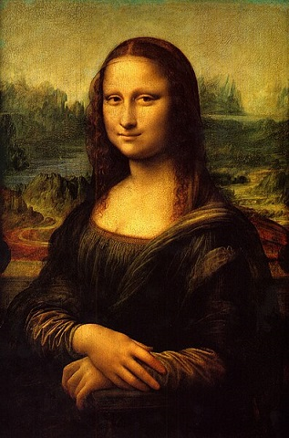

# Gallery Guess

Gallery Guess is a web-based guessing game where players identify famous artworks, their eras, and locations. Built with React and Vite, it offers an engaging way to test your art history knowledge.

## Features
- Guess the name, era, and museum of various artworks
- Interactive UI with hints and options
- Responsive design for desktop and mobile
- Score tracking and feedback

## Screenshots


## Getting Started

### Prerequisites
- Node.js (v16 or higher recommended)

### Installation
1. Clone the repository:
   ```powershell
   git clone https://github.com/Treasure-cd/Gallery-Guess.git
   cd Gallery-Guess
   ```
2. Install dependencies:
   ```powershell
   npm install
   ```
3. Start the development server:
   ```powershell
   npm run dev

## Project Structure
- `src/` - Source code
  - `components/` - Reusable React components
  - `pages/` - Main pages (Game, Start)
  - `assets/` - Images and static assets
- `public/` - Public images and icons
- `index.html` - Main HTML file

## Contributing
Pull requests are welcome! For major changes, please open an issue first to discuss what you would like to change.

## License
This project is licensed under the MIT License.

## Credits
- Art images from public domain and museum resources
- Built by Treasure-cd
